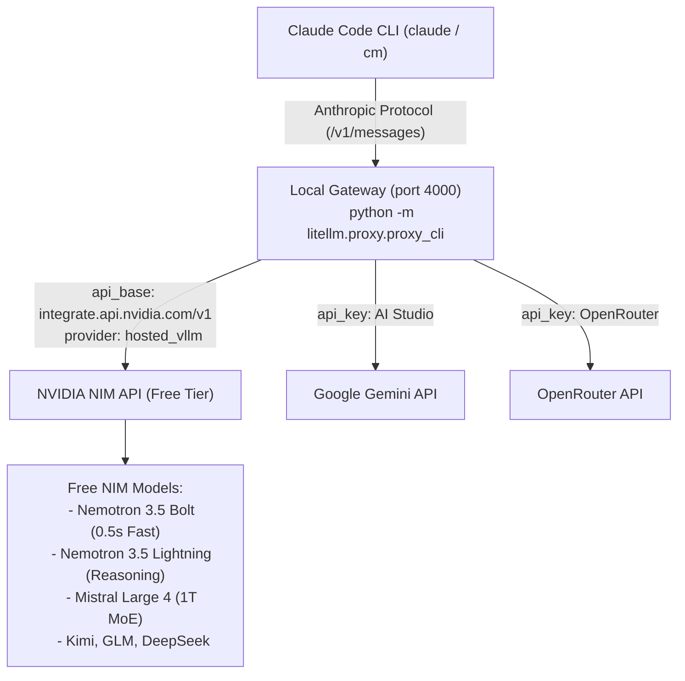

# Claude Code Free Multi-Provider Harness

A complete, portable harness that connects Anthropic's **Claude Code CLI** to **NVIDIA NIM**, **Google Gemini**, and **OpenRouter**, allowing you to run free-tier models (Nemotron, GLM, Kimi, DeepSeek, Mistral, Gemini, etc.) as autonomous coding agents without an Anthropic subscription.

---

## Table of Contents
1. [Architecture Overview](#architecture-overview)
2. [Quick Installation (1-Click)](#quick-installation-1-click)
3. [Prerequisites](#prerequisites)
4. [How to Add Other Free Models (GLM, Kimi, DeepSeek, etc.)](#how-to-add-other-free-models)
5. [Command Reference](#command-reference)
6. [Key Technical Discoveries & Best Practices](#key-technical-discoveries--best-practices)
7. [Repository File Map](#repository-file-map)

---

## Architecture Overview

Claude Code natively speaks Anthropic's Messages protocol (`/v1/messages`). This harness deploys a lightweight local LiteLLM translation proxy on `localhost:4000` that intercepts Anthropic calls, translates them to OpenAI-compatible `/chat/completions` calls for NVIDIA NIM / Gemini / OpenRouter, and translates the responses (including function calling and thinking tokens) back to Claude Code.



---

## Quick Installation (1-Click)

To set up this harness from scratch on any Windows machine:

### 1. Clone the Repository
```bash
git clone https://github.com/Ashwin312007/ClaudeCode.git
cd ClaudeCode
```

### 2. Run the Installer
- **Command Prompt / File Explorer**: Double-click or run:
  ```cmd
  install.bat
  ```
- **PowerShell**:
  ```powershell
  .\install.ps1
  ```

### 3. Set Your NVIDIA API Key
```bash
set-nvidia-key <your-nvapi-key>
```
*(This automatically validates your key against NVIDIA NIM and synchronizes it across all configs).*

### 4. Start the Gateway & Launch Claude Code
```bash
start-claude-gateway
```
In a new terminal or project folder:
```bash
claude
```

---

## Prerequisites

Ensure the following tools are installed on your machine:

1. **Node.js & Claude Code CLI**:
   ```bash
   npm install -g @anthropic-ai/claude-code
   ```
2. **Python 3.10+**:
   Installed and available on PATH (`python --version`).
3. **Python Packages**:
   ```bash
   pip install litellm InquirerPy
   ```
4. **NVIDIA API Key**:
   Create a free developer account at [build.nvidia.com](https://build.nvidia.com/settings/api-keys) to obtain your `nvapi-...` key.

---

## How to Add Other Free Models

You can easily plug in any new model from NVIDIA NIM, OpenRouter, or Gemini.

### Step 1: Add the Model to `litellm-config.yaml`
Open `%USERPROFILE%\.claude\litellm-config.yaml` (or edit `.claude\litellm-config.yaml` in this repository).

#### Case A: Adding an NVIDIA NIM Model (e.g. GLM-5.3-Flash, Kimi K2.6 / K3.1, DeepSeek)
> [!IMPORTANT]
> **Always use `hosted_vllm/<nvidia_model_id>`** as the model prefix for NVIDIA NIM. This prevents LiteLLM from hitting the unsupported `/responses` endpoint and forces standard `/chat/completions`.

```yaml
model_list:
  # Example: GLM 5.3 Flash
  - model_name: glm-flash
    litellm_params:
      model: hosted_vllm/z-ai/glm-5.3-flash
      api_base: https://integrate.api.nvidia.com/v1
      api_key: "os.environ/NVIDIA_API_KEY"

  # Example: Moonshot Kimi K2.6 / K3.1
  - model_name: kimi-pro
    litellm_params:
      model: hosted_vllm/moonshotai/kimi-k2.6
      api_base: https://integrate.api.nvidia.com/v1
      api_key: "os.environ/NVIDIA_API_KEY"

  # Example: DeepSeek V4.1 Flash
  - model_name: deepseek-flash
    litellm_params:
      model: hosted_vllm/deepseek-ai/deepseek-v4.1-flash
      api_base: https://integrate.api.nvidia.com/v1
      api_key: "os.environ/NVIDIA_API_KEY"
```

#### Case B: Adding an OpenRouter Free Model (`:free`)
OpenRouter hosts many models with free rate limits (e.g. Llama 3.3 70B, Qwen Coder, Gemma):
```yaml
  - model_name: llama-free
    litellm_params:
      model: openrouter/meta-llama/llama-3.3-70b-instruct:free
      api_key: "os.environ/OPENROUTER_API_KEY"

  - model_name: qwen-free
    litellm_params:
      model: openrouter/qwen/qwen-2.5-coder-32b-instruct:free
      api_key: "os.environ/OPENROUTER_API_KEY"
```

---

### Step 2: Add the Model to the Interactive Picker (`choose_model.py`)
Open `%USERPROFILE%\.claude\choose_model.py` and add an entry under `CURATED_MODELS`:
```python
CURATED_MODELS = [
    Separator("--- NVIDIA NIM Flash & High-Performance Models ---"),
    Choice("nemotron-bolt", name="NVIDIA NIM: Nemotron 3.5 Bolt (0.5s Ultra-Fast Flash - Default)"),
    Choice("glm-flash", name="NVIDIA NIM: GLM 5.3 Flash"),
    Choice("kimi-pro", name="NVIDIA NIM: Kimi K2.6 / K3.1 Pro (Reasoning)"),
    Choice("deepseek-flash", name="NVIDIA NIM: DeepSeek V4.1 Flash"),
    Choice("nemotron-lightning", name="NVIDIA NIM: Nemotron 3.5 Lightning (30B MoE Reasoning)"),
    Choice("mistral-large-4", name="NVIDIA NIM: Mistral Large 4 (1T Parameter MoE)"),
    ...
]
```

---

### Step 3: Switch & Run

#### Option 1: Interactive Picker
Run:
```bash
cm
```
(or `claude-model`). Use arrow keys or type to fuzzy-search your new model and hit Enter.

#### Option 2: Command Line Switch
```bash
claude-provider gateway glm-flash
```
or launch Claude Code directly:
```bash
claude --model glm-flash
```

---

## Command Reference

| Command | Description | Example |
| :--- | :--- | :--- |
| `start-claude-gateway` | Starts the LiteLLM translation proxy on `localhost:4000` | `start-claude-gateway` |
| `claude` | Starts Claude Code with the currently configured active model | `claude` |
| `cm` (or `claude-model`) | Opens the interactive fuzzy model picker | `cm` |
| `claude-model <model>` | Sets model and launches Claude Code immediately | `claude-model nemotron-bolt` |
| `claude-provider gateway [model]` | Switches active config to the local gateway (port 4000) | `claude-provider gateway` |
| `claude-provider openrouter [model]` | Switches active config to direct OpenRouter | `claude-provider openrouter` |
| `set-nvidia-key <key>` | Authenticates against NIM API and synchronizes all config files | `set-nvidia-key nvapi-...` |

---

## Key Technical Discoveries & Best Practices

### 1. Windows Application Control Bypass
On Windows systems with AppLocker or Application Control policies, invoking `.exe` binaries inside AppData (such as `%APPDATA%\Python\...\Scripts\litellm.exe`) is blocked.
- **Solution**: Always run the module through Python:
  ```cmd
  python -m litellm.proxy.proxy_cli --config "..." --port 4000 --drop_params --request_timeout 180
  ```

### 2. The `hosted_vllm/` Prefix Requirement
If you use the prefix `openai/<model_id>`, LiteLLM proxy attempts to call OpenAI's new `/v1/responses` endpoint when receiving Anthropic `/v1/messages` calls. NVIDIA NIM does not support `/responses` and returns `404 Not Found`.
- **Solution**: Use `hosted_vllm/<model_id>` with `api_base: https://integrate.api.nvidia.com/v1`. This forces LiteLLM to use `/v1/chat/completions` which NVIDIA NIM supports 100%.

### 3. Content Safety Screening Guardrails on NVIDIA NIM
Certain models on NVIDIA NIM (such as `minimaxai/minimax-m3.1-flash`) have strict external safety guardrails that produce false-positive `422 Unprocessable Content: {"error": {"message": "input rejected by content safety screening"}}` errors on Claude Code's internal CLI agent prompt.
- **Solution**: Use **`nvidia/nemotron-3.5-bolt-e4b`** or **`nvidia/nemotron-3.5-lightning-30b-a3b`**, which pass Claude Code agent prompts with zero safety false positives and support native structured function/tool calling.

---

## Repository File Map

```
E:\ClaudeCode\
├── .claude\
│   ├── litellm-config.yaml   # Proxy routing & model definitions (environment variable interpolation)
│   ├── settings.json         # Active Claude Code settings (base URL, auth token, active model)
│   ├── .env.example          # Template environment configuration file
│   ├── switch_provider.py    # Python CLI tool to switch modes/models
│   ├── choose_model.py       # InquirerPy interactive fuzzy model selector
│   └── set_nvidia_key.py     # API key validator and synchronizer
├── bin\
│   ├── start-claude-gateway.cmd # Starts the translation gateway on port 4000
│   ├── claude-model.cmd         # Launches model selector & Claude Code
│   ├── claude-provider.cmd      # CLI wrapper for switch_provider.py
│   ├── set-nvidia-key.cmd       # CLI wrapper for set_nvidia_key.py
│   └── cm.cmd                   # Short alias for claude-model
├── .gitignore                # Ignores .env and Python cache files
├── install.bat               # 1-click installer for Command Prompt
├── install.ps1               # 1-click installer for PowerShell
└── README.md                 # Complete documentation (this file)
```
